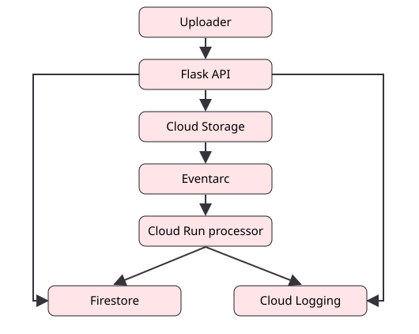

# DocuFlow

A college cloud computing project tracing a synthetic PDF from upload through validation to its final processing result. The first checkpoint defines the workflow. Application services and runtime tests follow scope approval.

Start with the [file policy](docs/file-policy.md), [state model](docs/state-machine.md), [metadata schema](docs/metadata-schema.md) and [draft event contract](docs/event-contract.md). See [progress](PROGRESS.md) for implementation status.

## Repository layout

The Flask API belongs in backend/, the separate Flask worker in processor/, and the same-origin HTML, CSS and JavaScript in frontend/. infra/ holds emulator and event wiring. baseline/ preserves the first implementation for comparison. tests/, samples/, scripts/ and evidence/ hold checks, generated fixtures, PowerShell entry points and observed results respectively.

After cloning, run `git config core.hooksPath .githooks` in PowerShell to activate the staged secret check. Keep credentials in the ignored local .env file.
