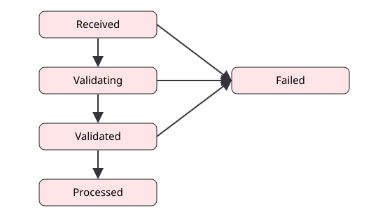

# Document lifecycle

Received means the upload has private storage and metadata. Validating begins when the worker claims the generation. Validated means all deep checks passed. Processed means the worker committed the extracted metadata and result. Failures during any active stage enter Failed with a safe reason and code.

Commit the state and its history entry in one transaction, conditioned on current attempt and expected prior state. Replaying a completed delivery changes neither. Recover an interrupted claim before acknowledging it. Retry transient errors with backoff up to twice, recording each retry. Permanent validation failures terminate immediately. Manual reprocessing allocates a fresh attempt for a Failed document, returning it to Received and preserving earlier history.
